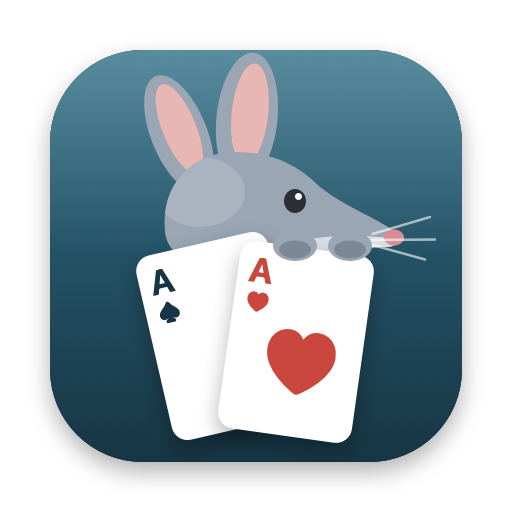

<p align="center">
  
</p>

<h1 align="center">Bilby</h1>

<p align="center">
  A calm, native poker tournament clock for Mac, iPad and iPhone.<br>
  B-il-B-y: it keeps an eye on the big blind.
</p>

<p align="center">
  <a href="https://github.com/kimiyuch/bilby.app/releases/latest/download/Bilby.dmg"><b>Download Bilby for Mac</b></a>
  ·
  <a href="https://bilby.kimiyu.ch">Website</a>
</p>

---

## Features

- **A clock you can read across the room**: level, blinds and ante, a big countdown, progress, the next level, time to the next break and time played
- **Turns amber** when a level is about to end, and teal during breaks
- **Start, pause, skip and adjust** with the space bar and arrow keys: next and previous level, a minute more or less, restart a level
- **Blind structures**: edit levels and breaks (with notes like "color up the 25s"), start from a turbo, standard or deep stack preset, or let Bilby generate one from your stack, players, chips and how long the game should last
- **Import and export** structures as JSON files
- **Players and prize pool**: buy-ins, rebuys, add-ons and fees, players left, chips in play, average stack, and payouts that follow the number of entries (and can be changed for each tournament)
- **Sounds and voice**: a warning a minute before the level ends, chimes for new levels and breaks, and spoken announcements ("Level 6. Blinds 200, 400, ante 400.")
- **Big screen**: on the Mac, a clock-only window that goes full screen on a TV or projector while you keep the controls
- **Menu bar countdown** on the Mac, and the display stays awake while the clock runs
- **Lock Screen and Dynamic Island** countdown on iPhone, and notifications for every level change and break, even with Bilby in the background
- **Never loses time**: the clock is based on when the level ends, not a counter, so it stays right through sleep, quitting and relaunching
- **Automatic updates** on the Mac

## Requirements

- A Mac with Apple Silicon (M1 or newer) and macOS 26 or newer
- An iPhone or iPad with iOS 26 or iPadOS 26 or newer (built from source for now)

## Installing

1. Download [Bilby.dmg](https://github.com/kimiyuch/bilby.app/releases/latest/download/Bilby.dmg) and drag Bilby to **Applications**.
2. Open Bilby. The first time, macOS will say it can't verify the developer, because Bilby isn't notarized by Apple.
3. Open **System Settings → Privacy & Security**, scroll down and click **Open Anyway**.

You only need to do this once. Bilby updates itself after that.

## Building from source

You need Xcode and [XcodeGen](https://github.com/yonaskolb/XcodeGen) (`brew install xcodegen`).

```sh
./build.sh        # builds build/Bilby.app
./make-dmg.sh     # builds build/Bilby.dmg
```

`build.sh` downloads [Sparkle](https://sparkle-project.org) into `vendor/` the first time, generates `Bilby.xcodeproj` from `project.yml` and builds the Mac app.

For iPhone and iPad, run `xcodegen generate`, open `Bilby.xcodeproj` and run the **Bilby** scheme on your device. To sign it, create `Config/Signing.local.xcconfig` with your team ID from Xcode → Settings → Accounts (a free Apple account works):

```
DEVELOPMENT_TEAM = ABCDE12345
```

The clock, structures and prize pool math live in the `BilbyKit` package and have their own tests:

```sh
cd BilbyKit && swift test
```

## Releasing

```sh
./release.sh 0.2 "What changed in this version"
```

This bumps the version in `project.yml`, builds the app and DMG, signs the update with the Sparkle key in your Keychain, writes `appcast.xml`, tags the commit and publishes a GitHub release. Bilby checks `releases/latest/download/appcast.xml`, so every installed copy sees the new version.

The signing key lives in the macOS Keychain (account `bilby`). Export it with `vendor/sparkle-2.10.0/bin/generate_keys --account bilby -x sparkle-private-key.txt` (that filename is gitignored) and keep a copy somewhere safe, like a password manager. Without it you can't publish updates to existing installs. To restore it on a new Mac, run `generate_keys --account bilby -f sparkle-private-key.txt`.

## How it's built

| Part | |
|---|---|
| `BilbyKit` | The clock, blind structures, the structure generator, presets and payouts, with tests |
| `App` | The SwiftUI app for Mac, iPad and iPhone |
| `Widgets` | The Live Activity for the Lock Screen and Dynamic Island |
| `scripts/make-icon.swift` | Draws the app icon |

## Credits

Bilby uses [Sparkle](https://sparkle-project.org) (MIT) for updates on the Mac. Its license ships inside the app under `Contents/Resources/Licenses`.

## License

Bilby is free software under the [MIT License](LICENSE).
